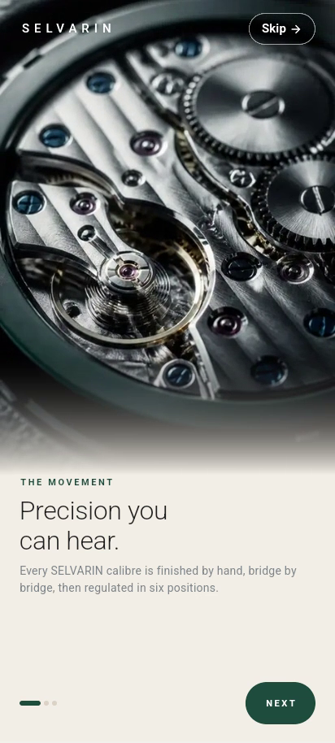
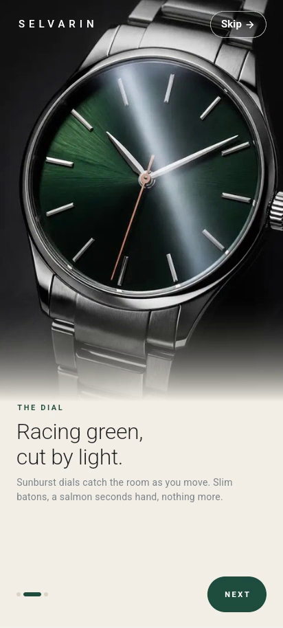
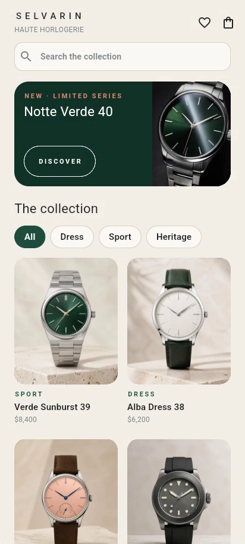
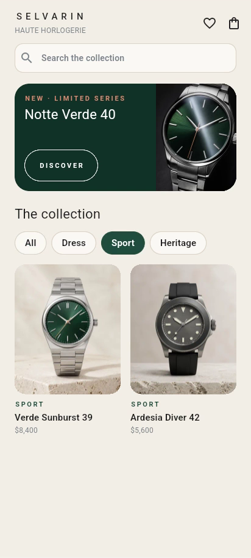
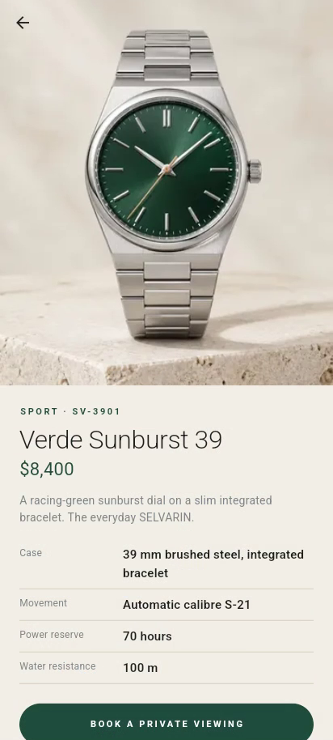

# SELVARIN · Haute Horlogerie

Day 2 of my public **10-day Flutter challenge** (2026-10-20): 10 days, 10 brands, 10 apps.
**SELVARIN** is a *fictional* luxury watch house: travertine light, racing-green sunburst dials, brushed steel and a salmon seconds hand. It is not a real brand, and all names, specs and prices in the app are invented.

The watch category was suggested by **sami ullah** in the comments on the challenge announcement. His feedback is also why every onboarding screen has a visible **Skip** that goes straight to the shop.

| Onboarding 1 | Onboarding 2 | Onboarding 3 | Home | Sport filter | Detail |
|---|---|---|---|---|---|
|  |  |  |  |  |  |

## Brand
- **Palette:** Alabaster `#F4F0E8`, Surface `#FBF9F5`, Racing Green `#1F4D3F`, Forest `#123329`, Graphite `#1D1F21`, Steel `#7D858B`, Salmon `#D98C73`
- **Type:** light, tightly set sans for display copy; bold, wide-tracked labels; a letter-spaced wordmark
- **Tone:** quiet precision. Short sentences, nothing shouted.

## Features
- 3 onboarding screens, each with a looping brand film (animated WebP), an animated page indicator and a Next / Shop the collection button
- A **Skip** button on every onboarding screen that goes straight to the shop
- Home: brand bar, search (`AppTextField`), featured banner, collection chips (All, Dress, Sport, Heritage), a lazy 2-column product grid with press-scale cards
- Product detail with a Hero image, price, specs and a "Book a private viewing" button (demo only)

## Architecture
```
lib/
  core/        constants, demo, routing, theme (tokens), utils, widgets (AppButton, AppText, AppTextField, BrandWordmark)
  features/
    onboarding/{data,domain,presentation}
    home/{data,domain,presentation}
```
- **State management: `flutter_riverpod`** (Notifier + NotifierProvider, `select`), picked at random for the day. See `../state-mgmt-log.md`.
- The domain layer defines the `ProductRepository` and `OnboardingRepository` interfaces. The data layer provides the local implementations, and Riverpod providers are the composition root (tests can override them).
- One class per file. Theme tokens cover colours, spacing, radii, sizes, typography and durations.

## Performance decisions
- `const` constructors throughout. Builds are split into small widget classes, never helper methods.
- Narrow rebuilds with Riverpod: each slide watches `onboardingIndexProvider.select((i) => i == pageIndex)`, each chip watches `homeProvider.select((s) => s.collection == collection)`, the footer watches a derived `onboardingIsLastProvider`, and only the grid watches `visibleProductsProvider`. The search field uses `ref.read`, so typing never rebuilds it.
- Onboarding films sit in a `RepaintBoundary`, and `TickerMode(enabled: active)` pauses the films on off-screen pages.
- Images decode at display size: `SizedAssetImage` wraps assets in `ResizeImage` with a width from `ImageCacheSize` (logical size × device pixel ratio).
- The onboarding films and the featured image are precached in `didChangeDependencies`, using the same `ResizeImage` keys the widgets draw with.
- `CustomScrollView` with `SliverGrid.builder` (lazy) and a `ValueKey` per product. The chips use a keyed `ListView.separated`.
- The card press-scale is local `setState` inside the card, so pressing one card rebuilds only that card.
- Assets: product images are WebP at 360×480 (about 2× card size, 11–18 KB each, ~87 KB total). Onboarding films are animated WebP at 480×854, 12 fps, 4 s loops (0.8–1.35 MB each).
- Strict analysis (`strict-casts`, `strict-inference`, `strict-raw-types`, `always_specify_types`, `prefer_const_*` and more), with zero issues.
- Release APK (split per ABI, `flutter build apk --release --split-per-abi`): arm64-v8a 20.4 MB, armeabi-v7a 17.7 MB, x86_64 21.8 MB. The three onboarding films are ~3.2 MB of that.

## Demo tour (for screen recordings)
`DemoTour.enabled` is a compile-time constant that is false unless you build with `--dart-define=DEMO_TOUR=true`. With it on, the app plays through onboarding (pausing on each slide), presses Skip, scrolls the shop, switches collections and opens a product, with no input. Normal builds never start it.

```bash
flutter run -d linux --dart-define=DEMO_TOUR=true
```

## Run
```bash
flutter pub get
flutter run            # Android device, or -d linux (412×915 window)
flutter test
```
Only runtime dependency: `flutter_riverpod` (MIT). Licensed under MIT, see LICENSE.

Note: SELVARIN is a fictional brand created for this challenge. It is not a real company or product.
